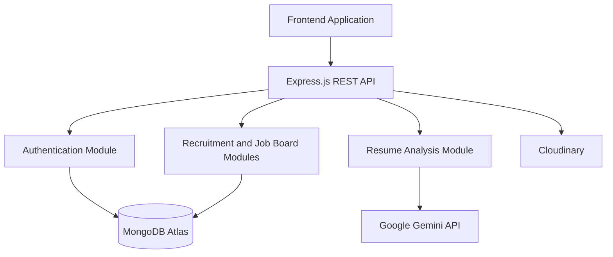

# Resumely – AI-Powered Applicant Tracking System & Job Board

Resumely is a full-stack recruitment platform designed to simplify and improve the hiring process. It combines Applicant Tracking System (ATS) capabilities with an integrated job board and AI-powered resume analysis to help streamline candidate screening and recruitment workflows.

The project was developed as part of an **Industry Architecture Workshop conducted by MyAnatomy from 19 November 2026 to 21 November 2026**, focusing on building software using industry-oriented architecture, practical development workflows, and modern application technologies.

## Key Features

- **User Authentication:** Secure user registration and login functionality.
- **Applicant Tracking:** Supports recruitment and candidate management workflows.
- **Job Board:** Provides an integrated platform for job-related activities.
- **AI-Powered Resume Analysis:** Uses Google Gemini API to support intelligent resume analysis.
- **Cloud-Based File Management:** Uses Cloudinary for managing uploaded files and media.
- **Database Management:** MongoDB Atlas with Mongoose for persistent data storage.
- **RESTful APIs:** Backend API architecture for communication between application components.
- **Environment Configuration:** Uses environment variables to manage application credentials and configuration.

## Technology Stack

| Category | Technology |
|---|---|
| Backend | Node.js |
| Backend Framework | Express.js |
| Database | MongoDB Atlas |
| ODM | Mongoose |
| AI Integration | Google Gemini API |
| File & Media Storage | Cloudinary |
| API Communication | REST APIs |
| Environment Management | dotenv |

*Add your actual frontend technologies here.*

## System Architecture

The application follows a modular client-server architecture, separating the frontend, backend services, database, and external integrations.



### Architecture Highlights

- Modular backend configuration and route organization.
- Separation of database connection, middleware, routes, and application logic.
- Centralized error-handling middleware.
- API security and request-rate limiting.
- External service integrations through configurable environment variables.
- Database connectivity established before starting the application server.

## Project Setup

### 1. Clone the repository

```bash
git clone YOUR_GITHUB_REPOSITORY_URL
cd "ATS With Job Board"
```

### 2. Install backend dependencies

```bash
cd backEnd
npm install
```

### 3. Configure environment variables

Create a `.env` file inside the `backEnd` directory.

Configure the following variables using your own credentials:

```env
PORT=4000

MONGO_URI=your_mongodb_connection_string
MONGO_DATABASE=resumely

GEMINI_API_KEY=your_gemini_api_key

CLOUDINARY_CLOUD_NAME=your_cloud_name
CLOUDINARY_API_KEY=your_cloudinary_api_key
CLOUDINARY_API_SECRET=your_cloudinary_api_secret
```

Use the exact environment variable names expected by your application configuration.

### 4. Start the backend

```bash
npm run dev
```

The backend should start on:

```text
http://localhost:4000
```

### 5. Verify the server

Open the following URL:

```text
http://localhost:4000/
```

The root endpoint returns the API service status and available endpoint information.

*